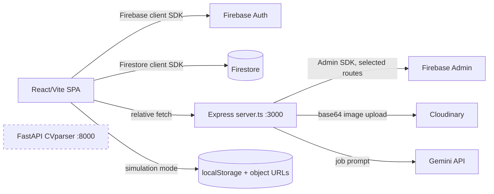
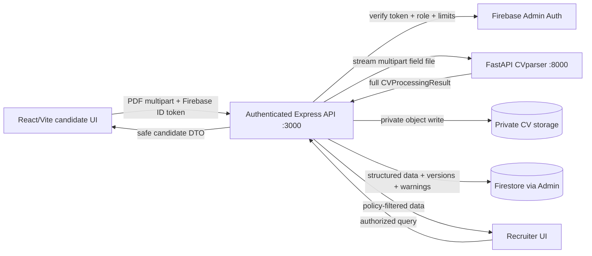

# CVparser Integration Audit

Audit date: 2026-08-06  
Repository root: `C:\Users\maryem\Desktop\project stage\cvtheque`  
Scope: read-only architecture, integration, security, compatibility, build, test, and runtime analysis. No integration was implemented.

## 1. Executive summary

The repository does **not** contain a Next.js application. The actual web application is a React 19 single-page application built with Vite 6, manually routed in `src/App.tsx`, and served together with an Express 4 API from `server.ts`. Bun is the intended package manager because `bun.lock` is the sole lock file. This distinction invalidates the CVparser project's example Next.js App Router handler as a copy-paste integration for this repository.

The current web application mixes four approaches:

1. client-side Firebase Authentication and Firestore access;
2. an Express API for health, some authentication/admin operations, Cloudinary upload, and Gemini job generation;
3. browser `localStorage` and in-memory object URLs when Firebase is not configured;
4. substantial simulated/static data, including CV scoring derived from filenames and random numbers.

The correct primary integration is **Mode A, adapted to the actual stack**: add an authenticated Express server endpoint in `server.ts` (preferably split into a router during the implementation phase only), stream/forward a multipart PDF to the separate FastAPI service, persist a safe structured record, and return a candidate-safe projection. The browser must not call FastAPI directly. Mode B is not presently available because no separate application backend exists. Mode C would couple Node and Python incorrectly. Mode D is acceptable only as a short-lived local diagnostic.

The candidate upload surface already exists inside `src/components/dashboard/candidate-view.tsx`, but it accepts PDF/DOC/DOCX, performs no real type or size enforcement, waits 1.5 seconds, uploads through the generic storage abstraction, and produces randomized, filename-based results. The recruiter view repeats a similar upload simulation. FastAPI accepts only a PDF in `multipart/form-data` field `file`, with a default 10 MiB and 20-page limit.

CVparser itself is mature and test-covered. Its existing Python 3.12.10 environment passed `pip check`, import and health smoke tests, and all **446 tests** with the optional model disabled. Its production endpoint is `POST /api/v1/cv/parse`. The HTTP response model is `CVProcessingResult`, not the unused richer `ParseCVResponse` model. Consequently, the real response contains `pipeline_result`, `cv_data`, `llm_used`, and `llm_available`; it does not currently expose parser/schema version metadata, input filename, or a top-level quality score.

Highest-priority blockers before integration are authentication/authorization enforcement on Express routes, credential remediation, a real private file-storage design, a persisted CV schema, multipart handling and timeouts in Express, explicit safe response projection, and resolving PDF-only versus the UI's advertised DOC/DOCX support.

## 2. Exact repository tree

Generated from the filesystem, including files ignored by Git where relevant. Existing virtual environments, caches, bytecode, logs, and generated test artifacts are summarized rather than expanded file-by-file.

```text
cvtheque/
├── .git/                              # present; status unavailable (git CLI absent)
├── .env.example
├── .gitignore
├── assets/
├── bun.lock
├── cloudinary_onboarding.js
├── firebase-applet-config.json
├── firebase-blueprint.json
├── firebase-service-account.json      # sensitive credential-shaped file
├── firestore.indexes.json
├── firestore.rules
├── index.html
├── metadata.json
├── package.json
├── server.ts
├── tsconfig.json
├── vite.config.ts
├── docs/
│   └── CVPARSER_INTEGRATION_AUDIT.md
├── src/
│   ├── App.tsx
│   ├── main.tsx
│   ├── index.css
│   ├── assets/images/logo_1784290198311.jpg
│   ├── components/
│   │   ├── auth/{google-login-button,login-form,register-form}.tsx
│   │   ├── dashboard/{admin-view,candidate-view,create-job-page,profile-view,recruiter-view,settings-view,unauthorized}.tsx
│   │   ├── layout/{app-navbar,app-sidebar,dashboard-layout}.tsx
│   │   └── ui/{count-up,empty-state,gooey-nav,loading-skeleton,logo,magic-bento,role-badge,stat-card}.tsx
│   ├── hooks/{useAuth,useCurrentUser}.ts
│   ├── lib/
│   │   ├── firebase/{admin,client,db}.ts
│   │   └── storage-service.ts
│   ├── providers/auth-provider.tsx
│   └── types/index.ts
└── CVparser/
    └── ai-cv-parser-api-&-test-studio (1)/
        ├── .env                         # not read or disclosed
        ├── .env.example
        ├── .gitignore
        ├── .venv-llm/                   # existing Python 3.12.10 environment
        ├── .pytest*/                    # pre-existing caches/artifacts
        ├── api/                         # present directory; no source files observed
        ├── app/
        │   ├── main.py
        │   ├── api/dependencies.py
        │   ├── api/routes/{cv,health}.py
        │   ├── core/{config,constants,exceptions,logging,skill_catalog}.py
        │   ├── extractors/{base_extractor,certifications_extractor,education_extractor,experience_extractor,identity_extractor,languages_extractor,skills_extractor,summary_extractor}.py
        │   ├── llm/{base_client,client_factory,prompt_builder,qwen_client,response_parser}.py
        │   ├── models/{cv_models,extraction_models,ocr_models,response_models}.py
        │   ├── services/{cv_extraction_service,cv_processing_service,extraction_pipeline_service,layout_service,llm_extraction_service,ocr_service,pdf_service,section_service}.py
        │   ├── ui/{gradio_app,presenters}.py
        │   └── utils/{json_utils,list_utils,text_cleaning,timing}.py
        ├── assets/
        ├── docs/{dependencies,nextjs-integration}.md
        ├── scripts/{cv_input,download_model,eval_harness,setup_llm_windows,validate_qwen_local}.py/.ps1
        ├── tests/
        │   ├── conftest.py
        │   ├── fixtures/{manual_cv_manifest.example.json,synthetic_cv.txt}
        │   └── 38 test_*.py modules
        ├── README.md
        ├── TESTING.md
        ├── pytest.ini
        ├── requirements.txt
        ├── requirements-dev.txt
        ├── requirements-llm.txt
        ├── requirements-lock.txt
        └── requirements-ui.txt
```

No `AGENTS.md` or `CONTRIBUTING.md` was found. No `next.config.*`, `app/`, `pages/`, Prisma, Dockerfile, or Compose file exists at the web-project root.

## 3. Frontend technology stack

| Concern | Actual implementation | Evidence / consequence |
|---|---|---|
| Framework | React 19 SPA, **not Next.js** | `react`, `react-dom`; `src/main.tsx`; Vite entry |
| Build/dev | Vite 6; Express + `tsx` dev server | `vite.config.ts`, `server.ts`, scripts |
| Language | TypeScript/TSX, with `allowJs` and non-strict configuration | `tsconfig.json`; no `strict: true` |
| Routing | Manual `window.history.pushState` and path switch | `src/App.tsx`; no React Router |
| Styling | Tailwind CSS 4 Vite plugin plus large custom `src/index.css` | `@tailwindcss/vite` |
| UI/animation | Lucide, Motion, GSAP, custom components | No packaged component system such as MUI/shadcn |
| Authentication | Firebase Auth in configured mode; local simulated identity otherwise | `auth-provider.tsx` |
| Database | Browser Firebase Firestore SDK or `localStorage` mocks | `src/lib/firebase/db.ts` |
| Server database | Firebase Admin available only for selected Express operations | `src/lib/firebase/admin.ts`, `server.ts` |
| Validation/forms | Zod 4 + React Hook Form on auth; ad hoc state elsewhere | Upload forms do not use a shared schema |
| API client | Native `fetch`, no wrapper or Axios | Relative Express endpoints |
| State management | Local React state and one auth context | No Redux/Zustand/Query cache |
| Notifications | Sonner | Toasts throughout dashboard/auth |
| Storage | Local object URL mock, unimplemented Firebase storage, or Cloudinary proxy | Runtime selection in `storage-service.ts` |

There are no React Server Components, server actions, Next.js layouts, middleware, route handlers, or Pages/App Router semantics.

## 4. CVparser technology stack

| Concern | Implementation |
|---|---|
| API | FastAPI 0.110–<0.140, Uvicorn 0.17–<0.31 |
| Validation | Pydantic 2.6–<2.14 and pydantic-settings |
| Upload parsing | `python-multipart`; FastAPI `UploadFile` |
| PDF | PyMuPDF (`fitz`) |
| OCR | Tesseract via `pytesseract`, Pillow; OCR only when native text is insufficient |
| Extraction | Deterministic regex/rules and section/layout processing |
| Optional LLM | Local Qwen2.5 through optional Torch/Transformers dependencies; disabled by default and lazy-loaded |
| Demo UI | Optional Gradio 4.20–<4.40 |
| Tests | pytest, pytest-asyncio, httpx; 446 tests observed |

## 5. Package managers and runtime versions

| Project | Manager/runtime | Finding |
|---|---|---|
| Web | Bun | `bun.lock` is the only JS lock; no `packageManager` field is declared. Bun executable is unavailable on this machine. |
| Web runtime | Node | Installed Node is `v24.15.0`; no `.nvmrc`, `.node-version`, `engines`, or Volta pin exists. Vite 6 compatibility should be certified against a supported LTS, preferably Node 22, before release. |
| Python | venv/pip | Existing `.venv-llm` is Python `3.12.10`; system `python` is 3.14.4 and must not be used for release certification. |
| Python support documentation | inconsistent | README requires 3.12; `docs/dependencies.md` says validated 3.11.2. CI prose says 3.12. Treat 3.12 as authoritative and reconcile docs. |

## 6. Installation commands used

No dependencies were installed and no lock file was changed.

- Web install not run: Bun is unavailable and `node_modules` is absent. The reproducible future command is `bun install --frozen-lockfile` after Bun is installed and after change-producing installation is approved.
- Python install not run: the existing environment was preserved.
- Python dependency integrity command: `.\.venv-llm\Scripts\python.exe -m pip check` → `No broken requirements found.`

## 7. Build and test results

| Target | Command/check | Result | Classification |
|---|---|---|---|
| Web lint/typecheck | `bun run lint` | Not run: Bun unavailable and dependencies absent | Environment/missing dependency |
| Web tests | package scripts inspected | No test script configured | Configuration gap |
| Web production build | `bun run build` | Not run for same reason | Environment/missing dependency |
| CVparser first pytest | `python -m pytest -q -p no:cacheprovider` | 440 passed, 6 setup errors; default temp directory denied | Environment permission, not code defects |
| CVparser supported pytest | same plus workspace `--basetemp` | **446 passed, 53 warnings, 17.36 s** | Success |
| Python import | import `app.main:app` | `IMPORT_OK AI CV Parser API 1.0.0` | Success |
| Health smoke | in-process `TestClient.get('/health')` | HTTP 200, `status=ok`, model disabled | Success |
| Routes smoke | enumerate FastAPI routes | `/health`, `/api/v1/cv/parse`, `/docs`, `/redoc`, `/openapi.json` | Success |

Warnings were third-party deprecations from `python-multipart` and Gradio/FastAPI lifespan APIs. Qwen inference was never enabled and no model was downloaded. The temporary pytest base directory was removed.

The web server was not started because its dependencies are absent. FastAPI was verified in-process rather than bound to a port; this tests application creation and routing without leaving a background process.

## 8. Current architecture



CVparser is currently isolated: there is no import, environment variable, fetch call, proxy route, persistence mapping, or UI contract connecting it to the web platform.

## 9. Web route map

Routes are client-side path states, not filesystem routes. Express serves the SPA fallback only in production.

| Path | Audience | Purpose/components | Data/status |
|---|---|---|---|
| `/` | Any | Redirects authenticated users to role dashboard; unauthenticated to login | Auth-context state |
| `/login` | Guest | `LoginForm`; email/password or Google | Real Firebase if configured; otherwise mock user lookup; no Express login dependency |
| `/register` | Guest | `RegisterForm`; role selection and auth | Firebase/client Firestore or mock |
| `/forgot-password` | Guest | Inline screen in `App.tsx` | Firebase email or console-only simulation |
| `/dashboard/candidate` | Candidate | `CandidateView`: CV upload/history, score, applications/job matching, interview history | Mix of Firestore/local mocks, randomized matching, static interviews |
| `/dashboard/recruiter` | Recruiter/Admin | `RecruiterView`: jobs, CV library, simulated matching, direct sourcing upload | Firestore/local mocks and random/keyword calculations |
| `/dashboard/recruiter/create-job` | Recruiter/Admin | `CreateJobPage` with Gemini assistant and structured form | Express Gemini API plus Firestore/local persistence |
| `/create-job` | Recruiter/Admin | Alias of create-job page | Same as above |
| `/dashboard/admin` | Admin | `AdminView`: user CRUD, filters, stats | Client DB engine plus unauthenticated Express admin routes |
| `/profile` | Authenticated | `ProfileView`: names and avatar upload | Auth context, db engine, generic storage |
| `/settings` | Authenticated | `SettingsView` | Predominantly static UI |
| `/unauthorized` | Authenticated | `Unauthorized` | Client-side role redirect assistance |
| `/dashboard/{role}/...` | Varies | Broad prefix fallbacks | Many unimplemented paths collapse to a parent view |

Unknown authenticated paths fall through to `CandidateView`, which is a routing and authorization risk. Client route guards improve UX but do not secure server APIs.

## 10. Candidate interface map

| Capability | Location | Actual status |
|---|---|---|
| Registration/login | auth forms and `auth-provider.tsx` | Firebase-capable; insecure simulation mode intentionally bypasses password checks |
| Dashboard | `candidate-view.tsx` | Implemented UI; mixed mock/Firestore data |
| CV selection/drop | `candidate-view.tsx` | Implemented; stores `File` and filename in React state |
| Basic validation | same | UI advertises 5 MB but enforces neither size nor MIME/signature; accepts PDF, DOCX, DOC |
| CV upload/storage | `db.ts` → `storage-service.ts` | Generic file upload; local mode is session-only object URL; Cloudinary path may be public; Firebase storage class is unimplemented |
| CV parse/result | `db.ts` and view cards | Fake: delay, randomized score/feedback, filename keyword skills |
| CV preview | result filename link | Only if a non-`#` file URL exists; no structured CV preview/editor |
| Applications/recommendations | candidate view | Matching is randomized/static, not persisted application workflow |
| Interviews | candidate view | Static history widget |

The candidate view is the correct owner for selection, validation feedback, progress, candidate-safe parsed result, and confirmation/edit UI. Parsing and persistence must be owned by Express, not this component.

## 11. Recruiter interface map

| Capability | Location | Actual status |
|---|---|---|
| Dashboard/jobs | `recruiter-view.tsx` | Firestore/local data |
| Job creation | `create-job-page.tsx` | Form persistence plus Gemini assistant |
| Candidate library | `recruiter-view.tsx` | All CV records via `getAllCVs`; Firestore rules allow recruiters to read all CVs |
| Direct sourcing upload | `recruiter-view.tsx` | Simulated; accepts PDF/DOCX, no enforced 5 MB limit |
| Candidate detail | modal over `CandidateCV` | Limited to filename, score, feedback, skills |
| Ranking/matching | `getMatchScore` | Client-side heuristic combining random `aiScore` and title/description keyword matches |
| Shortlist/campaign | none | Not implemented as durable entities or routes |

Candidate self-upload should be integrated first. Recruiter direct upload requires a distinct lawful-basis/consent, ownership, retention, and authorization design and should not silently reuse candidate semantics.

## 12. Important component inventory

| File / component | Props and state | Dependencies | Render mode | Reuse and risk |
|---|---|---|---|---|
| `src/App.tsx` / `AppContent` | path state; auth context | All major views, browser History API | Client only | Keep route ownership; manual fallback and client-only guards are weak |
| `candidate-view.tsx` / `CandidateView` | CV/job/loading/upload/file/drag/modal/match state; no props | `dbEngine`, auth, Sonner | Client only | Primary candidate integration surface; replace simulation carefully, retain layout |
| `recruiter-view.tsx` / `RecruiterView` | optional `onNavigate`; job/CV/upload/filter/modal state | `dbEngine`, Sonner | Client only | Reusable result list/modal; direct upload needs separate authorization and PDF-only contract |
| `types/index.ts` / `CandidateCV` | flat record | Used by candidate/recruiter/db | Shared TS | Must evolve or be complemented; lacks structured data, metadata, warnings, parser state/version |
| `firebase/db.ts` / `dbEngine` | stateless methods | Firebase client or localStorage; storage service | Browser data layer | Current `uploadCV` must not parse; random scoring must be retired from production flow |
| `storage-service.ts` | `uploadFile/deleteFile/getFileUrl` | FileReader, Express Cloudinary | Browser abstraction | Generic binary interface reusable, but current Cloudinary endpoint is image-oriented/public and unsuitable for private CVs |
| `auth-provider.tsx` / `AuthProvider` | user/profile/loading/simulation/modal state | Firebase/client db/localStorage | Client only | Reuse for UI identity; Express must verify ID tokens independently |
| `dashboard-layout.tsx` | title/path/navigation/children | auth/navbar/sidebar | Client only | Reusable shell and command palette |
| `loading-skeleton.tsx` | class/variant/id | none | Client | Reusable while list/result loads; not upload byte progress |
| `empty-state.tsx` | title/description/icon/action | none | Client | Reusable for no-CV/error recovery states |
| `create-job-page.tsx` | extensive form/chat state | `/api/jobs/ai-generate`, db engine | Client | Job contract may later consume parsed skills; unrelated to initial parser transport |
| `profile-view.tsx` | names/photo/upload state | auth, db, storage | Client | Identity prefill candidate; must not auto-overwrite verified account identity from parsed CV |
| `login-form.tsx`, `register-form.tsx` | callbacks/id; RHF state | Zod, auth context | Client | Existing validation pattern can guide upload schema/error UX |
| `stat-card.tsx`, `role-badge.tsx`, `magic-bento.tsx` | presentational props | animation | Client | Presentation only; no parser coupling |

No JSON viewer exists. Showing raw `pipeline_result` in the product UI is not recommended.

## 13. Existing Express API/backend architecture

| Method/path | Purpose | Authentication/authorization | Data source |
|---|---|---|---|
| `GET /api/health` | Server/Firebase mode | None | Process state |
| `POST /api/cloudinary/upload` | Base64 upload | None | Cloudinary |
| `POST /api/auth/register` | Admin SDK user/profile creation or simulation | None; caller can submit role | Firebase Admin/mock |
| `DELETE /api/admin/users/:uid` | Delete user | None | Firebase Admin |
| `PUT /api/admin/users/:uid` | Update user including role/status | None | Firebase Admin |
| `POST /api/auth/login` | Mock/proxy acknowledgement | None; does not verify password | Static response |
| `POST /api/auth/logout` | Mock acknowledgement | None; no server session | Static response |
| `POST /api/jobs/ai-generate` | Gemini job generation | None | External Gemini API |
| `GET /api/auth/me` | Token profile | Bearer checked; real verification only when Admin configured; a special simulated token can bypass | Firebase Admin/static mock |
| `GET /api/users/me` | Static profile | Checks only Bearer prefix | Static mock |

The server uses JSON/urlencoded parsers at 10 MB and has no multipart middleware. A future CV endpoint therefore needs multipart streaming/parsing with limits; sending a PDF as JSON/base64 would inflate size, increase memory use, and contradict FastAPI's contract.

## 14. CVparser API contract

### Startup and discovery

- App: `CVparser/.../app/main.py`, export `app`
- Documented startup: `python -m uvicorn app.main:app --host 127.0.0.1 --port 8000`
- Config defaults: `APP_HOST=127.0.0.1`, `APP_PORT=8000`
- Health: `GET /health`
- Swagger: `GET /docs`; ReDoc: `/redoc`; OpenAPI: `/openapi.json`
- Main production endpoint: `POST /api/v1/cv/parse`

### Exact request

```http
POST /api/v1/cv/parse
Content-Type: multipart/form-data; boundary=...

file=<PDF bytes>
```

The field name is exactly `file`. Accepted declared content types are `application/pdf` and `application/octet-stream`; the bytes must be nonempty and, after leading whitespace, begin with `%PDF-`. Default maximums are 10 MiB and 20 pages. The service reads in 64 KiB chunks but accumulates the accepted file in memory before processing.

### Exact success response

The route declares `response_model=CVProcessingResult`:

```json
{
  "pipeline_result": {
    "raw_text": "...",
    "cleaned_text": "...",
    "sections": {"SKILLS": "..."},
    "detected_sections": ["SKILLS"],
    "pages": [
      {
        "page_number": 1,
        "native_text": "...",
        "native_text_length": 123,
        "native_text_ratio": 1.0,
        "ocr_text": null,
        "final_text": "...",
        "extraction_method": "native_pdf",
        "layout_type": "single_column",
        "left_column_text": null,
        "right_column_text": null,
        "ocr_used": false,
        "warnings": []
      }
    ],
    "extraction_method": "native_pdf",
    "warnings": [],
    "pipeline_steps": [{"name": "pdf_validation", "status": "success", "duration_ms": 1.2, "message": null}],
    "total_pages": 1,
    "processing_time_seconds": 0.1
  },
  "cv_data": {
    "identity": {
      "full_name": null,
      "email": null,
      "phone": null,
      "linkedin": null,
      "github": null,
      "website": null,
      "location": null,
      "job_title": null,
      "other_links": []
    },
    "summary": null,
    "skills": [{"name": "Python", "category": "programming_language", "source": "skills_section"}],
    "languages": [{"language": "French", "level": "Fluent", "original_level": "courant"}],
    "certifications": [{"name": "...", "issuer": null, "date": null, "credential_id": null}],
    "education": [{"degree": null, "field_of_study": null, "institution": null, "location": null, "start_date": null, "end_date": null, "description": null}],
    "experiences": [{"job_title": null, "company": null, "location": null, "start_date": null, "end_date": null, "description": null}],
    "warnings": []
  },
  "llm_used": false,
  "llm_available": false
}
```

Fields with `exclude=True` are intentionally absent from serialized pages: OCR token/line counts, confidence values, engine, detected-column count, and reconstructed-region count.

### Errors

Controlled errors use:

```json
{
  "error": "InvalidPDFError",
  "code": "INVALID_PDF",
  "detail": "human-readable detail",
  "extra_data": null,
  "timestamp": "ISO-8601"
}
```

Relevant statuses/codes include 400 `INVALID_PDF`, 413 `FILE_TOO_LARGE` or `PDF_PAGE_LIMIT_EXCEEDED`, 415 `UNSUPPORTED_FILE_TYPE`, 422 extraction errors and `IMAGE_ONLY_PDF`, plus sanitized 500 `INTERNAL_SERVER_ERROR`. FastAPI framework validation errors may use FastAPI's normal 422 `detail` array rather than this envelope.

### OCR and image-only behavior

The pipeline prefers native selectable PDF text. It can use Tesseract when native text is below configured thresholds (`MIN_NATIVE_TEXT_CHARS_PER_PAGE=50`, `MIN_NATIVE_TEXT_RATIO=0.6`). However, image-only CVs are explicitly rejected with `IMAGE_ONLY_PDF`/422 in the unsupported path, and the health endpoint currently reports `ocr_available=false` unconditionally rather than probing Tesseract. Production policy must be clarified: either certify OCR and expose accurate readiness, or consistently reject scanned/image-only CVs with candidate guidance.

### LLM behavior and limits

`MODEL_ENABLED=false` by default; `MODEL_LOCAL_FILES_ONLY=true`; deterministic extraction remains the source of truth. The optional client fills missing fields only, validates support against CV text, preserves deterministic values, bounds context, and adds warnings on failures/unsupported output. `llm_used` means enrichment ran successfully; `llm_available` means the configured client was available. Neither flag should be presented to candidates as a quality score.

### Performance characteristics

Processing is synchronous CPU work offloaded from the async route through `run_in_threadpool`. Files are held in memory. Native PDFs should be materially faster than OCR; optional local LLM adds hardware-dependent latency. No request timeout, concurrency limit, queue, rate limit, or benchmark SLA is defined in the API contract. The observed complete unit suite timing is not a parse latency benchmark.

## 15. Response-field exposure policy

| Field | Use | Exposure recommendation |
|---|---|---|
| `cv_data.identity`, summary, skills, education, experiences, languages, certifications | Candidate review/prefill and recruiter-authorized structured profile | Return a deliberate DTO; candidate can view/edit their own data |
| `cv_data.warnings` | User-relevant extraction uncertainty | Map allowlisted codes/messages to friendly text; retain original server-side |
| `pipeline_result.extraction_method`, `total_pages`, `processing_time_seconds` | Operations/audit metadata | Store server-side; optionally expose simple completion metadata |
| `pipeline_result.raw_text`, `cleaned_text`, `sections`, page text/columns | Debugging and parser trace | Backend-only, restricted, retention-limited; never default browser payload |
| `pipeline_steps`, per-page warnings/layout/OCR flags | Diagnostics/performance | Backend-only/operator role |
| `llm_used`, `llm_available` | Reproducibility/operations | Store server-side; do not expose availability topology to ordinary users |

`ParseCVResponse`, `ExtractionMetadata`, diagnostics, validation anomaly, and quality models exist in `response_models.py` but are **not returned by the current route**. Integration must follow generated OpenAPI/current route behavior, not these unused model names.

## 16. Recommended architecture



**Primary recommendation: Mode A, Express server proxy/orchestrator.** It fits the existing co-located backend, keeps `CV_PARSER_API_URL` private, allows Firebase ID-token verification, centralizes file/record ownership, prevents raw diagnostics from reaching the browser, normalizes errors, and avoids CORS dependence. A direct browser call is unsuitable for production because FastAPI has no platform authentication or tenant/recruiter authorization.

Mode comparison:

| Mode | Fit | Decision |
|---|---|---|
| A. Server route proxies | Strong, using Express rather than Next route handler | Recommended |
| B. Separate existing backend calls parser | No such backend is present | Not applicable now |
| C. Import into Python backend | No platform Python backend; couples deployment/runtime | Reject |
| D. Browser → FastAPI | Useful only for isolated local diagnostics | Do not ship |

## 17. Exact future upload sequence

```mermaid
sequenceDiagram
  actor C as Candidate
  participant UI as CandidateView
  participant E as Express API
  participant A as Firebase Admin
  participant P as CVparser FastAPI
  participant S as Private storage
  participant D as Firestore

  C->>UI: Select/drop PDF
  UI->>UI: Check extension/MIME/size; show selected file
  UI->>E: multipart file + Firebase ID token
  E->>A: Verify token and active candidate role
  A-->>E: uid/claims
  E->>E: Recheck size, signature, ownership, rate limit
  E->>S: Store original privately or stage safely
  E->>P: POST /api/v1/cv/parse, field=file
  P-->>E: CVProcessingResult or normalized error
  E->>D: Transactional metadata + structured JSON + versions + warnings
  E-->>UI: Candidate-safe DTO
  UI-->>C: Review extracted fields and friendly warnings
```

Ownership by existing/new surfaces:

1. `CandidateView` selects a **PDF only**, enforces a first-pass 10 MiB ceiling aligned to server configuration, displays progress/state, and sends multipart data.
2. A new Express CV route authenticates with Firebase Admin; `App.tsx` guards are not security controls.
3. Express forwards unchanged bytes using field `file` and does not manually set the multipart boundary.
4. CVparser validates signature/page count and parses deterministically.
5. Express stores the original in private object storage, never the current public/image-oriented Cloudinary route without an approved private-delivery design.
6. Express persists: owner uid, opaque storage key, original filename/type/size, structured JSON, explicit schema version, parser service/version, warnings, parse status, timestamps, and retry/idempotency key.
7. Express strips diagnostics and sends the safe DTO.
8. Candidate UI renders identity, summary, skills, education, experience, languages, certifications, and actionable warnings, ideally with confirmation/edit controls.
9. Recruiter UI reads only authorized, candidate-consented data through an authenticated API; it must not query unrestricted raw parser records directly from the browser.

## 18. Data-contract mapping

Recommended database paths are proposed because no structured CV database schema exists yet; they must be agreed before implementation.

```mermaid
flowchart LR
  R[CVparser CVProcessingResult] --> M[Express mapper + policy filter]
  M --> J[(cvs/{cvId}.structuredData)]
  M --> DTO[CandidateCVDetail DTO]
  DTO --> V[Candidate/recruiter views]
```

| CVparser source | Frontend display | Proposed backend field | Mismatch/action required |
|---|---|---|---|
| `cv_data.identity.full_name` | Candidate name | `structuredData.identity.fullName` | Current profile splits `firstName`/`lastName`; do not guess split or overwrite account identity |
| `.email` | Contact email | `structuredData.identity.email` | May differ from auth email; classify as CV contact data |
| `.phone` | Phone | `structuredData.identity.phone` | No current `CandidateCV` field |
| `.location` | Location | `structuredData.identity.location` | No current candidate CV field |
| `.job_title` | Current/target title | `structuredData.identity.jobTitle` | No current field |
| `cv_data.summary` | Professional summary | `structuredData.summary` | Current `feedback` is synthetic analysis, not summary |
| `cv_data.skills[].name/category/source` | Skill chips; category optional | `structuredData.skills[]` | Current `skills` is `string[]`; retain objects in DB and project names for legacy cards |
| `cv_data.education[]` | Education cards | `structuredData.education[]` | Entirely absent currently; dates are unnormalized strings |
| `cv_data.experiences[]` | Experience timeline | `structuredData.experiences[]` | Parser plural is `experiences`; agree naming in TS DTO |
| `cv_data.languages[]` | Language + level | `structuredData.languages[]` | Job requirements use `{name, minimum_level}` while parser uses `{language, level, original_level}` |
| `cv_data.certifications[]` | Certification list | `structuredData.certifications[]` | Entirely absent currently |
| `cv_data.warnings[]` | Friendly warning banners | `parser.warnings[]` plus mapped `userWarnings[]` | Warnings are free-form English/French strings, not stable codes |
| `pipeline_result.extraction_method` | Usually hidden | `parser.extractionMethod` | Backend-only operational metadata |
| `.total_pages` | Optional “N pages processed” | `file.pageCount` | Not in current `CandidateCV` |
| `.processing_time_seconds` | Usually hidden | `parser.processingTimeSeconds` | Server metric only |
| `.pipeline_steps`, `.pages`, `.raw_text`, `.cleaned_text`, `.sections` | None | Separate restricted diagnostic record if needed | Must not live in broadly readable `cvs` documents by default |
| `llm_used`, `llm_available` | None | `parser.llmUsed`, `parser.llmAvailable` | Operational topology; not a score |
| API app `version=1.0.0` | None | `parser.version` | Not in response; Express needs configured/deployment metadata or parser must later expose it safely |
| integration schema version | None | `schemaVersion` | Does not exist; define independently of parser app version |

The existing `aiScore` has no corresponding CVparser field. CV parsing and candidate-to-job matching are separate concerns; do not synthesize a parser score. Likewise `feedback` is not returned by CVparser. Any later scoring engine needs its own versioned contract and evidence.

## 19. Environment variables

Values are intentionally omitted.

### Existing web variables

`GEMINI_API_KEY`, `APP_URL`, `NEXT_PUBLIC_FIREBASE_API_KEY`, `NEXT_PUBLIC_FIREBASE_AUTH_DOMAIN`, `NEXT_PUBLIC_FIREBASE_PROJECT_ID`, `NEXT_PUBLIC_FIREBASE_STORAGE_BUCKET`, `NEXT_PUBLIC_FIREBASE_MESSAGING_SENDER_ID`, `NEXT_PUBLIC_FIREBASE_APP_ID`, `FIREBASE_PROJECT_ID`, `FIREBASE_CLIENT_EMAIL`, `FIREBASE_PRIVATE_KEY`, `CLOUDINARY_CLOUD_NAME`, `CLOUDINARY_API_KEY`, `CLOUDINARY_API_SECRET`.

Because this is Vite, client variables should use `VITE_` prefixes. The code currently supports both `VITE_FIREBASE_*` and misleading `NEXT_PUBLIC_FIREBASE_*` names, while `.env.example` documents only the latter. Only Firebase browser configuration may be public; Admin, Cloudinary secret, Gemini, and future parser URL must remain server-only.

### CVparser variables

`APP_NAME`, `APP_HOST`, `APP_PORT`, `NEXTJS_ORIGIN`, `LOG_LEVEL`, `MAX_FILE_SIZE_MB`, `MAX_PDF_PAGES`, `MODEL_NAME`, `MODEL_ENABLED`, `MODEL_LOCAL_FILES_ONLY`, `MODEL_DEVICE`, `MODEL_TORCH_DTYPE`, `MODEL_MAX_NEW_TOKENS`, `MODEL_DO_SAMPLE`, `MODEL_TEMPERATURE`, `MODEL_TOP_P`, `MODEL_REPETITION_PENALTY`, `MODEL_TRUST_REMOTE_CODE`, `MIN_NATIVE_TEXT_CHARS_PER_PAGE`, `MIN_NATIVE_TEXT_RATIO`, `OCR_LANGUAGES`, `TESSERACT_CMD`, `OCR_LAYOUT_MODE`, `OCR_MIN_CONFIDENCE`, `SKILLS_CATALOG_PATH`.

`OCR_MIN_CONFIDENCE` exists in code but was not listed in the inspected CVparser `.env.example` output; align it. Gradio documentation also refers to `GRADIO_SERVER_NAME`, `GRADIO_SERVER_PORT`, and `GRADIO_SHARE`.

### Future server-only web variables

- `CV_PARSER_API_URL` — e.g. internal `http://127.0.0.1:8000`; never `VITE_`/`NEXT_PUBLIC_`.
- `CV_PARSER_TIMEOUT_MS` — explicit server timeout, chosen after benchmarks.
- `CV_UPLOAD_MAX_BYTES` — aligned to FastAPI limit or discovered centrally.
- Storage bucket/signing/retention configuration for private documents.
- `CV_SCHEMA_VERSION` and deployed parser version/revision if not provided by service.

## 20. Ports and CORS

| Item | Current | Requirement |
|---|---|---|
| Web | Hard-coded Express `3000` | Keep unless made configurable deliberately |
| FastAPI | Defaults/documented `8000` | User suggested 8001, but project already defines 8000; do not silently change |
| Gradio | 7860 | Development only; not part of production integration |
| CORS origin | `NEXTJS_ORIGIN=http://localhost:3000`, one origin | Rename eventually to framework-neutral `WEB_ORIGIN`; with server-to-server proxy, browser CORS is not required |
| Bind address | Express `0.0.0.0`; FastAPI documented `127.0.0.1` | Co-hosted dev is compatible; deployed services need private network/service DNS |

Express and FastAPI have no port collision. The FastAPI setting `APP_PORT` is not automatically consumed by the documented CLI if a different `--port` is passed.

## 21. Security and privacy findings

Severity reflects integration/release risk.

| Severity | Finding | Evidence / impact | Required response |
|---|---|---|---|
| Critical | Credential material is present in source files | `server.ts` contains fallback Cloudinary credentials; `firebase-service-account.json` contains service-account/private-key fields | Revoke/rotate affected credentials, remove hard-coded fallbacks and credential files from version control/history, load server secrets only from a secret manager/environment |
| Critical | Privileged Express routes lack auth/RBAC | Admin user CRUD, registration role input, Cloudinary upload, and Gemini route have no verified bearer middleware | Implement one Firebase Admin token verifier and role/active-user authorization before adding CV endpoint |
| High | CV storage is not privacy-ready | Local mock is ephemeral; Firebase storage class unimplemented; Cloudinary endpoint is image-oriented and returns an accessible URL | Choose private object storage, opaque keys, signed short-lived retrieval, delete/retention policies |
| High | Raw CVs/records are browser-managed | Firestore client writes and reads `cvs`; recruiters can read all CV documents | Separate restricted parser diagnostics; enforce least privilege, campaign/consent scope, and server-side queries |
| High | No real upload enforcement | UI advertises 5 MB but checks neither size nor type/signature; accepts DOC/DOCX while parser is PDF-only | Validate in UI and Express; parser remains final authority; align 10 MiB/20-page contract |
| High | Simulation can resemble production | Mock login ignores password; server endpoints return mock identities; random CV “AI” scores are labeled as analysis | Explicit environment gating/banner; fail closed in production when Firebase/Admin config is absent |
| High | Generic errors leak internals | Several Express catches return `error.message`; logs include exceptions and upload URLs | Normalize safe errors; attach correlation IDs; redact PII/paths/tokens |
| Medium | Client guards are mistaken for authorization | `App.tsx` role redirects only; unknown routes fall back to candidate view | Server authorization on every sensitive operation; tighten routing |
| Medium | Root `.gitignore` protects `.env*` but not credential JSON | `.env` ignored, `.env.example` allowed; service-account filename not ignored | Add secret-file policy during remediation; scan history without printing secrets |
| Medium | Public-prefix naming is incorrect for Vite | `NEXT_PUBLIC_*` accepted/documented; Vite convention is `VITE_*` | Migrate public config names; never give secret vars a public prefix |
| Medium | CORS permits all methods/headers with credentials for one configured origin | FastAPI `CORSMiddleware` | Proxy eliminates need; otherwise restrict methods/headers and exact deployment origins |
| Medium | Parser logs controlled error detail and full exceptions | Could include document-derived context/local paths server-side | Apply structured redaction, restricted log access, and retention limits |
| Medium | No rate limit, concurrency bound, malware policy, or timeout | PDF/OCR is CPU/memory intensive | Add rate limiting, request timeout, bounded workers/queue, PDF hardening/malware policy |
| Low | Health readiness is misleading for OCR | Hard-coded `ocr_available=false` even if installed | Separate liveness/readiness and report real supported capabilities without sensitive hardware detail |

The report intentionally does not reproduce any credential value, `.env` value, CV content, or local model path.

## 22. Compatibility and schema mismatches

1. Framework: integration documentation assumes Next.js App Router; actual server is Express/Vite.
2. Transport: FastAPI requires multipart; Express currently only parses JSON/urlencoded bodies.
3. File types: candidate UI accepts PDF/DOC/DOCX and recruiter UI PDF/DOCX; parser accepts PDF only.
4. Limits: UI text says 5 MB without enforcement; parser enforces 10 MiB and 20 pages; Express JSON limit is 10 MB but irrelevant/inadequate for multipart.
5. Data model: `CandidateCV` is flat and scoring-focused; parser is nested and extraction-focused.
6. Skills: frontend `string[]`; parser `Skill[]` with name/category/source.
7. Languages: job requirements use `name/minimum_level`; parser uses `language/level/original_level`.
8. Experience naming: parser uses `experiences`; future frontend conventions may prefer `experience`.
9. Name: auth profile requires first/last names; parser returns one `full_name`.
10. Missing scoring: parser returns no `aiScore`, matching, recommendation, or narrative `feedback`.
11. Warning stability: parser warnings are human strings rather than stable structured codes.
12. Versioning: parser app version exists in FastAPI metadata but not parse response; no schema version exists.
13. Response-model ambiguity: unused `ParseCVResponse` is richer than actual `CVProcessingResult` route response.
14. Image-only/OCR policy: code has OCR and an explicit image-only rejection path; readiness reports OCR unavailable. Product behavior needs certification.
15. CORS naming: `NEXTJS_ORIGIN` is misleading and supports one origin, while the app is Vite.
16. Runtime: web has no Node/Bun version pin; installed Node 24 is not a declared certified runtime.
17. OS: root `clean` script uses Unix `rm -rf`, unsuitable in plain Windows PowerShell; audit did not run it.
18. Docker/deployment: neither project supplies Docker/Compose support, health orchestration, or service networking.
19. Error envelopes: Express commonly returns `{error}`; CVparser returns structured controlled errors; FastAPI validation can return `{detail: [...]}`.
20. Timeout: no caller/server parser timeout or cancellation contract exists.

## 23. Risks and required changes before integration

Ordered prerequisites:

1. Rotate and remove exposed/hard-coded credential material; add secret scanning and fail-closed configuration.
2. Establish authenticated Express middleware using Firebase Admin ID-token verification plus role and `isActive` checks.
3. Define a private CV storage, deletion, retention, consent, recruiter-access, and audit policy.
4. Define versioned TypeScript/API/database DTOs and a safe projection that excludes raw diagnostics.
5. Add an Express multipart upload route with field/size/signature limits, abort timeout, and normalized errors.
6. Align UI and parser to PDF-only, 10 MiB, and 20 pages, or explicitly add a separately reviewed DOC conversion service later.
7. Decide synchronous request versus queued job after measuring representative synthetic PDFs, OCR, and concurrency. Initial synchronous integration can work only with explicit timeouts and bounded workload.
8. Add schema/parser version metadata and idempotency/retry semantics.
9. Separate parsing from job matching. Remove/random-score production claims rather than mapping them to parser output.
10. Tighten Firestore schema/rules and consider moving CV persistence fully behind Express Admin operations.
11. Reconcile Python 3.11 versus 3.12 documentation and OCR readiness behavior.
12. Pin supported Bun and Node versions; make a clean frozen install and capture a baseline build before code changes.

## 24. Recommended implementation phases

### Phase 0 — Environment and baseline

- Objective: establish reproducible, secret-safe baselines.
- Likely files: `package.json`, a runtime-version file, `.env.example`, deployment docs; security remediation may affect `server.ts` and credential files.
- Tests: `bun install --frozen-lockfile`, `bun run lint`, `bun run build`; Python `pip check`, 446-test baseline.
- Risks/dependencies: credential rotation requires infrastructure owner; Bun currently absent.
- Acceptance: clean builds on pinned supported runtimes; no repository secrets; simulation cannot activate in production.

### Phase 1 — Shared contracts

- Objective: define versioned parser input, internal result, safe candidate DTO, error codes, and persisted schema.
- Likely files: `src/types/index.ts` or new `src/types/cv-parser.ts`; server validation module; contract fixtures.
- Tests: TS schema unit tests against sanitized Python fixture/OpenAPI samples; null/list/date mismatch cases.
- Risks/dependencies: decide naming, full-name handling, warning codes, parser/version source.
- Acceptance: actual `CVProcessingResult` validates; raw diagnostics cannot appear in safe DTO.

### Phase 2 — Backend/server integration

- Objective: authenticated Express multipart endpoint calls FastAPI safely.
- Likely files: `server.ts`, preferably new `src/server/auth.ts`, `src/server/routes/cv.ts`, `src/server/services/cv-parser-client.ts` if restructuring is approved.
- Tests: missing/invalid token, wrong role, wrong MIME/signature, oversized file, parser 400/413/415/422/500, timeout/unavailable parser, multipart boundary.
- Risks/dependencies: multipart library addition, timeout/stream behavior, authorization middleware.
- Acceptance: browser never sees parser URL; only owner can upload; errors are normalized and diagnostics stripped.

### Phase 3 — Candidate upload UI

- Objective: replace candidate simulation with real PDF state machine and review UI while preserving visual design.
- Likely files: `candidate-view.tsx`, new focused uploader/result components, shared types.
- Tests: selection/drop, PDF/size validation, progress, retry, cancellation, accessible error and success states.
- Risks/dependencies: current monolithic component and 1.5-second timer.
- Acceptance: no fake success/random score; exact server outcome displayed in candidate-friendly form.

### Phase 4 — Persistence

- Objective: store private original reference and versioned structured output atomically/idempotently.
- Likely files: server storage/repository modules, `firestore.rules`, `firestore.indexes.json`, types; no migration tool currently exists.
- Tests: ownership, duplicate retries, partial parser/storage failures, deletion cascade, recruiter access scope.
- Risks/dependencies: storage provider, retention policy, existing flat records.
- Acceptance: original is private; records contain schema/parser versions, warnings, status, timestamps; no orphan on failure.

### Phase 5 — Error and warning presentation

- Objective: stable parser-error mapping and actionable localized warnings.
- Likely files: server error mapper, uploader/result UI, translation/message catalog.
- Tests: every known status/code, FastAPI validation envelope, scanned CV guidance, unknown 500, no raw exception/path.
- Risks/dependencies: current warnings are unstructured free text.
- Acceptance: safe consistent UI messages; full diagnostics restricted to operators.

### Phase 6 — End-to-end tests

- Objective: certify the complete upload and authorized retrieval flow using synthetic documents only.
- Likely files: test configuration/fixtures; possibly Playwright/Vitest dependencies after approval.
- Tests: native one/two-column PDFs, multilingual, missing fields, 20/21 pages, near/over limit, corrupted/spoofed PDF, image-only policy, concurrent uploads.
- Risks/dependencies: no web test framework exists; OCR/Tesseract availability.
- Acceptance: deterministic E2E results, no real PII, retry/idempotency verified, all negative paths pass.

### Phase 7 — Security and deployment verification

- Objective: production readiness, observability, least privilege, networking, and data lifecycle.
- Likely files: deployment manifests/Dockerfiles, env templates, security rules, logging config, operations docs.
- Tests: secret scan, dependency scan without autofix, authorization matrix, rate/load tests, log-redaction test, retention/deletion, liveness/readiness.
- Risks/dependencies: deployment platform and privacy owner decisions.
- Acceptance: FastAPI private-only; TLS/service authentication where required; alerts/SLOs; approved privacy and retention controls.

## 25. Exact files likely to be modified later

- `server.ts` (or approved extraction into new Express server modules)
- `package.json` and `bun.lock` only if a multipart/test dependency is approved
- `.env.example` (names/placeholders only)
- `src/types/index.ts` and/or new CV contract type files
- `src/components/dashboard/candidate-view.tsx`
- likely new `src/components/cv/*` uploader/result/warning components
- `src/components/dashboard/recruiter-view.tsx` only after candidate flow and recruiter policy
- `src/lib/firebase/db.ts` or new server-side CV repository
- `src/lib/storage-service.ts` or replacement private-storage client/server service
- `firestore.rules` and `firestore.indexes.json`
- future server auth, parser-client, storage, and test modules
- deployment configuration not currently present

## 26. Files that must remain untouched during initial integration

Unless a separately reviewed defect requires a change:

- deterministic parser algorithms under `CVparser/.../app/extractors/`, `services/`, and `utils/`
- CVparser request/response schemas and route path during the first integration
- CVparser tests and synthetic fixtures
- optional LLM implementation and model-download scripts
- `.venv-llm`, any model cache/weights, and existing `.env`
- `bun.lock` unless an explicitly approved dependency change is necessary
- working visual-only UI components (`logo`, `magic-bento`, `gooey-nav`, stat/count components)
- unrelated admin, settings, profile, and job-creation business UI
- real Firebase/Cloudinary credential files must not be edited casually; remediation should revoke/remove them through a dedicated security change, not overwrite values in place

## 27. Acceptance criteria for the integration

1. Only authenticated active candidates can upload their own PDFs; recruiter ingestion has separate explicit authorization.
2. Browser calls same-origin Express and never knows the internal FastAPI URL.
3. UI and both servers enforce PDF-only and aligned size limits; FastAPI enforces 20 pages.
4. Multipart field is exactly `file`; boundaries are generated by the HTTP client.
5. Original files are private, retrievable only through authorized short-lived access, and deletable under policy.
6. Structured output, schema version, parser version, warnings, status, timestamps, file metadata/reference, owner, and idempotency key persist correctly.
7. Candidate receives only a safe DTO; `raw_text`, `cleaned_text`, page text, sections, pipeline steps, paths, exceptions, and infrastructure flags are absent.
8. Candidate can review all mapped identity, summary, skills, education, experience, language, and certification fields without account identity being silently overwritten.
9. Parser errors 400/413/415/422/500, validation errors, timeout, and unavailability have safe stable UI outcomes.
10. No random score or simulated feedback is represented as parser output.
11. Recruiter access is policy-scoped, server-authorized, auditable, and excludes restricted diagnostics.
12. Frozen web install, typecheck, build, Python tests, API contract tests, E2E negative tests, and security tests pass on pinned supported runtimes.
13. No secrets or raw CV PII appear in source, browser logs, server logs, telemetry, or error payloads.
14. Qwen remains optional/local-only and disabled unless separately certified; integration succeeds deterministically without it.

## 28. Remaining questions and assumptions

1. Which deployment platform and service topology will host Express, FastAPI, Firestore, and private file storage?
2. Is candidate upload strictly PDF-only, or is DOC/DOCX conversion a real requirement? CVparser currently cannot accept Office files.
3. Should scanned/image-only PDFs be rejected, or must Tesseract OCR be a certified production dependency? Current code and health semantics are ambiguous.
4. What is the lawful basis, consent model, retention duration, and deletion SLA for candidate and recruiter-sourced CVs?
5. May every recruiter see every CV, as current Firestore rules allow, or only candidates attached to their jobs/campaigns/tenant?
6. Is Firestore the approved durable database, and what private object-storage provider is approved?
7. Should candidates edit/confirm parsed fields, and must those edits remain separate from immutable parser output for provenance?
8. What parser version identifier should be persisted: API semantic version, commit SHA, container digest, or all three?
9. Are parsing requests expected to complete synchronously, or should uploads create asynchronous jobs? Representative latency/concurrency targets are absent.
10. Is job matching a separate service/phase? CVparser does not produce a match score or recommendation.
11. Should the richer unused `ParseCVResponse` become the API contract later, or remain internal/dead code? Do not change it during initial integration without versioning.
12. Which languages/locales must user-facing warnings support?
13. Is simulation mode required beyond local demos, and how will production fail closed when configuration is missing?
14. Git worktree status remains unknown because `git` was not installed/on `PATH`; existing user changes must be checked on a machine with Git before implementation.

## Audit command record

Read-only discovery used PowerShell `Get-ChildItem`/`Get-Content`, `rg --files`, and targeted `rg` searches. Runtime checks used Node/Python version commands, the existing Python interpreter, `pip check`, pytest with the model disabled, application import, route enumeration, and FastAPI `TestClient` health. No network calls, dependency downloads, model downloads, migrations, Git writes, application-file edits, or real CV uploads occurred.

## Phase 1 implementation update — 2026-08-06

Phases 0–3 of the candidate-side transport and review flow have now been implemented. The React browser sends a PDF to the authenticated same-origin Express endpoint `POST /api/cv/parse`; Express verifies the Firebase ID token and active candidate profile, validates the bounded multipart upload, calls the unchanged FastAPI endpoint, and reconstructs a browser-safe DTO. The candidate view keeps the result in React state and renders it separately for review. Final private-file and Firestore persistence remains deferred to Phase 4.

The previous audit findings about unrelated unprotected Express routes remain open. This phase intentionally secured only the new CV route. Hard-coded Cloudinary credential fallbacks were removed, but any credentials previously exposed in source or repository history **must be revoked and rotated by the project owner**.

See `docs/CVPARSER_INTEGRATION_PHASE_1.md` for the exact implementation, contracts, verification results, and remaining work.
