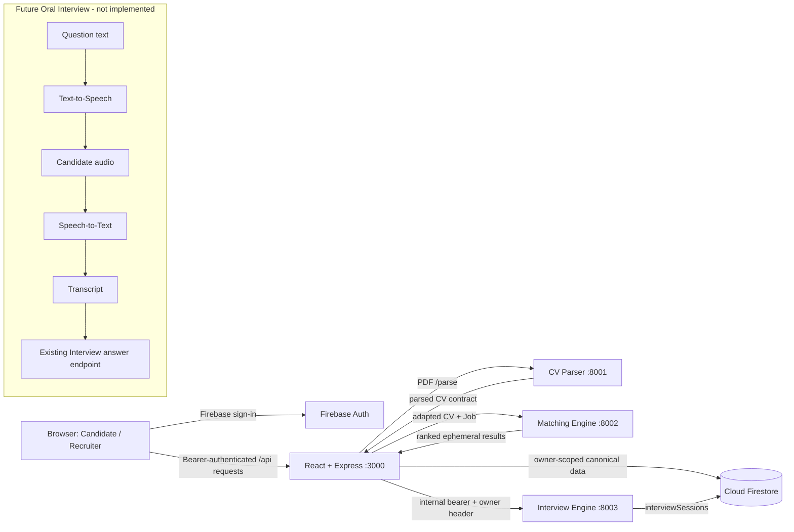

# Developer Handoff

## Project status

The core development flow was verified end to end against one unified Firebase
development project:

| Area | Status |
| --- | --- |
| Firebase target and persistence | PASS |
| Candidate and Recruiter authentication | PASS |
| Role and owner isolation | PASS |
| Candidate CV upload/parser/persistence | PASS |
| Recruiter Job creation/persistence | PASS |
| Recruiter matching | PASS |
| Candidate text Interview (mock provider, Firestore repository) | PASS |
| Production build and focused/full service regressions | PASS |
| Oral Interview | **Not implemented or verified** |

The retained development data consists of the fictional Alex Martin CanonicalCV,
the OPEN Synthetic Backend Engineer CanonicalJob, and one completed mock text
Interview session. Do not treat this synthetic data as production data.

## Architecture and verified flows

The browser talks only to the Express application. Express verifies Firebase ID
tokens and roles, owns canonical Firestore access, and calls the Python services.
The Matching Engine computes results on demand. The Interview Engine persists
session state in Firestore for the verified workflow.



Candidate flow: register/login -> upload PDF -> CV Parser -> CanonicalCV v1 ->
Firestore -> view OPEN Jobs -> start/complete a text Interview.

Recruiter flow: register/login -> create CanonicalJob v1 -> Firestore -> run
matching -> view ranked candidate-safe results.

## Stable contracts: preserve these

- `CanonicalCV` schema version 1 and its `PROCESSED`/`isCurrent` invariants.
- `CanonicalJob` schema version 1, OPEN-job projection, and recruiter ownership.
- Firebase `users/{uid}` role/profile model and one unified Firebase target.
- Candidate and Recruiter middleware must derive identity from verified tokens,
  never request bodies or browser-selected identifiers.
- Matching request/response adapters and runtime validation. Results are computed
  on demand and are not persisted.
- Interview internal bearer authentication, `X-Interview-Owner-Id` propagation,
  owner-scoped repository behavior, and `interviewSessions` persistence.
- Privacy boundaries: do not log IDs, tokens, authorization/owner headers, raw
  CV/Job payloads, answers, contact data, or credential paths.

## Services

| Service | Directory / stack | Responsibility | Port / health | Start command |
| --- | --- | --- | --- | --- |
| Main application | root; TypeScript, React, Vite, Express | Browser UI, Firebase auth boundary, canonical persistence, service orchestration | 3000; `/api/health` | `npm.cmd run dev` |
| CV Parser | `CVparser/ai-cv-parser-api-&-test-studio (1)`; Python/FastAPI | Text/OCR extraction and canonical parser response | 8001; `/health` | `npm.cmd run dev:parser` |
| Matching Engine | `matching-engine`; Python/FastAPI/Pydantic | Deterministic CV-to-Job scoring/ranking | 8002; `/health` | `npm.cmd run dev:matching` |
| Interview Engine | `interviewEngine`; Python/FastAPI/Pydantic | Question/evaluation state machine and session persistence | 8003; `/health` | `npm.cmd run dev:interview` |

Start only the service required by the feature being exercised. The Parser is not
needed for matching an already canonical CV; Parser and Matcher are not needed for
an Interview over retained canonical inputs.

### Dependencies

- Node.js LTS and `npm install` at the repository root.
- Python 3.12 for Parser and Interview Engine; Python 3.11+ for Matching Engine.
- Separate Python virtual environments per service.
- Tesseract only for image/OCR PDFs; native-text parsing does not require it.
- Firebase development project and an uncommitted Admin credential.
- No Gemini dependency for deterministic CV, Job, Matching, or mock Interview flows.

## Environment setup

Copy example files; never commit the resulting `.env` files.

```powershell
Copy-Item .env.example .env
Copy-Item "CVparser/ai-cv-parser-api-&-test-studio (1)/.env.example" "CVparser/ai-cv-parser-api-&-test-studio (1)/.env"
Copy-Item matching-engine/.env.example matching-engine/.env
Copy-Item interviewEngine/.env.example interviewEngine/.env
```

Root variables:

| Category | Variables |
| --- | --- |
| Public client configuration | `VITE_FIREBASE_API_KEY`, `VITE_FIREBASE_AUTH_DOMAIN`, `VITE_FIREBASE_PROJECT_ID`, `VITE_FIREBASE_STORAGE_BUCKET`, `VITE_FIREBASE_MESSAGING_SENDER_ID`, `VITE_FIREBASE_APP_ID` |
| Server secret | `FIREBASE_CLIENT_EMAIL`, `FIREBASE_PRIVATE_KEY`, `INTERVIEW_ENGINE_API_TOKEN`, optional `GEMINI_API_KEY`, optional Cloudinary credentials |
| Local file path | `FIREBASE_CREDENTIALS_FILE` |
| Local service configuration | `CV_PARSER_API_URL`, `CV_PARSER_TIMEOUT_MS`, `CV_UPLOAD_MAX_BYTES`, `CV_PARSER_VERSION`, `MATCHING_ENGINE_URL`, `MATCHING_ENGINE_TIMEOUT_MS`, `INTERVIEW_ENGINE_BASE_URL`, `INTERVIEW_ENGINE_TIMEOUT_MS` |

Parser variables are documented in its `.env.example`. For the verified local
path use `MODEL_ENABLED=false`; model paths, Tesseract, OCR, and catalog paths are
optional local configuration. Matching is deterministic and needs no model or
secret. Its host, port, and log level are optional development settings.

For the verified Interview persistence path use placeholders such as:

```env
INTERVIEW_PROVIDER=mock
INTERVIEW_REPOSITORY=firestore
INTERVIEW_FIRESTORE_COLLECTION=interviewSessions
INTERVIEW_FIREBASE_PROJECT_ID=<development-project-id>
INTERVIEW_FIREBASE_CREDENTIALS_FILE=<uncommitted-local-path>
INTERVIEW_INTERNAL_AUTH_ENABLED=true
INTERVIEW_INTERNAL_API_TOKEN=<same-process-secret-used-by-express>
```

The Express `INTERVIEW_ENGINE_API_TOKEN` and Engine
`INTERVIEW_INTERNAL_API_TOKEN` must match. Keep them server/process-only; never
use a `VITE_` variable. Other Interview limits/provider settings are listed in
`interviewEngine/.env.example`.

## Firebase setup

- `.firebaserc` selects the unified development target; confirm it before any
  deployment. Do not silently point one service at a different project.
- Browser Firebase uses the public `VITE_FIREBASE_*` application identifiers.
- Express and the Firestore Interview repository use Admin credentials from
  environment variables or an explicitly configured, ignored local file.
- Collections: `users`, `cvs`, `jobs`, and `interviewSessions`.
- `users/{uid}` contains the active role profile. Canonical CVs are candidate
  owned; Jobs are recruiter owned; Interview sessions are owner scoped.
- Firestore rules and indexes live in `firestore.rules` and
  `firestore.indexes.json`; deployment is an explicit operator action, not part
  of startup.
- Never commit a service-account JSON. A previously tracked development
  credential must be revoked/rotated by an authorized Firebase owner before the
  repository is shared; removing it from the current index does not erase Git
  history.

## Startup guide

From the repository root:

1. Always start the main application: `npm.cmd run dev`.
2. For CV upload/parsing only: `npm.cmd run dev:parser`.
3. For matching only: `npm.cmd run dev:matching`.
4. For text Interview only: configure mock + Firestore + matching internal tokens,
   then run `npm.cmd run dev:interview`.

Health checks:

```powershell
Invoke-RestMethod http://localhost:3000/api/health
Invoke-RestMethod http://127.0.0.1:8001/health
Invoke-RestMethod http://127.0.0.1:8002/health
Invoke-RestMethod http://127.0.0.1:8003/health
```

On Windows, run Python services outside restrictive/sandboxed networking when
they use Firestore/gRPC. A sandboxed Interview process previously passed health
but hung on Firestore; verify a narrow owner-scoped read before manual E2E.

## Test guide

Main application:

```powershell
npm.cmd run lint
npm.cmd run test:auth
npm.cmd run test:admin
npm.cmd run test:cv
npm.cmd run test:jobs
npm.cmd run test:candidate-jobs
npm.cmd run test:matching
npm.cmd run test:contracts
npm.cmd run test:interviews
npm.cmd run test:interview-frontend
npm.cmd run test:interview-history
npm.cmd run build
```

CV Parser (from its directory, deterministic suite):

```powershell
& .\.venv-llm\Scripts\python.exe -m pytest -m "not llm"
```

Matching Engine (from `matching-engine`):

```powershell
py -3.12 -m pytest
```

Matching currently has neither a pinned Ruff dependency/configuration nor a mypy
configuration. Do not treat an arbitrary globally installed Ruff ruleset as its
release gate; add and baseline lint configuration deliberately in a future
maintenance change. Interview Engine (from `interviewEngine`):

```powershell
py -3.12 -m pytest
py -3.12 -m ruff check app tests
py -3.12 -m mypy app
```

Tests are offline unless explicitly labeled as a live/E2E workflow. Do not run
browser E2E, Firebase mutation scripts, or Gemini benchmarks during ordinary
regression.

## Repository inventory and hygiene

- Source: `src`, `server.ts`, each Python service's `app`, and tests.
- Configuration: root/service `.env.example`, `package.json`, Python project and
  requirement files, Firebase rules/indexes/CLI configuration.
- Documentation: root `README.md`, `docs`, and service README/docs directories.
- Generated/local-only: `dist`, `node_modules`, virtual environments, downloaded
  models, `*.egg-info`, logs, `__pycache__`, pytest/Ruff/mypy caches.
- Development fixture: `tmp/candidate-cv-e2e.pdf` is fictional and intentionally
  retained for deterministic local E2E.
- Secrets/local environment: `.env`, credentials directories, service-account
  JSON, private keys, and machine-specific model/credential paths must remain
  ignored and untracked.

## Known non-blocking limitations

1. Oral Interview is pending.
2. Text Interview E2E used the mock provider; it proves integration and state,
   not production Gemini response quality.
3. Matching experience duration is unavailable when CV dates lack enough bounded
   duration data (for example, a null end date). Unknown duration does not invent
   experience evidence.
4. Matching results are intentionally ephemeral.
5. The production build reports a bundle-size advisory; build correctness passes.
6. Windows sandbox/network restrictions can make Firestore gRPC calls hang even
   while `/health` succeeds.
7. Optional profile image/Cloudinary code and the unused legacy mock-style login
   endpoint predate the verified Firebase-authenticated core. Review their auth,
   error, and logging boundaries before exposing them beyond local development.
8. Some older audit documents contain machine-specific historical paths; treat
   those documents as evidence, not portable startup instructions.

## Next development priorities

1. **Oral Interview**
   - Browser microphone permission and recording UX.
   - Audio lifetime, size/type limits, cancellation, and accessibility states.
   - Speech-to-Text producing a bounded transcript.
   - Text-to-Speech for question playback.
   - Reuse the existing authenticated Interview flow: transcript -> current answer
     endpoint -> current evaluation/state machine.
   - Oral E2E with mock/deterministic providers before any paid service.
   - Explicit audio privacy, retention, deletion, consent, and logging policy.
2. Review/secure or retire the legacy profile-image and mock login paths.
3. Validate production Gemini Interview quality separately before enabling it.
4. Add bundle code splitting if page-load performance becomes a release concern.
5. Continue any unfinished optional model/OCR and administrative workflows only
   after preserving the canonical and ownership contracts above.

## Handoff checklist

1. Revoke/rotate the historically committed development service account before
   sharing access; do not re-add the JSON.
2. Copy example environments and supply local secrets out of band.
3. Confirm all Firebase targets are the intended development project.
4. Run the offline test guide and production build.
5. Start only the services needed for the next task.
6. Preserve retained synthetic inputs if they remain useful, and never modify
   unrelated real/development documents during future E2E.
7. Begin Oral Interview as an adapter around the existing text answer contract;
   do not fork or weaken Interview authentication, ownership, or persistence.
