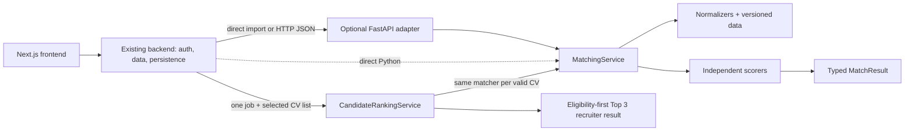

# Architecture

The Pydantic schemas validate known structures and ignore unknown upstream fields. This permits parser evolution while ensuring unknown or sensitive attributes never reach scorers. Normalizers are deterministic and filesystem paths resolve from module locations. Scorers have no network, database, authentication, UI, or mutable global dependencies.

The service is stateless. FastAPI only accepts JSON, enforces a request-size limit, invokes the service, serializes the result, and maps expected errors. Complete CVs, names, and sensitive data are never logged.

Candidate and job databases remain exclusively behind the existing backend. Ranking neither queries nor stores database records. The backend authenticates and authorizes recruiters, loads one job and the selected CV documents, calls ranking, optionally persists versioned results, and returns a safe response to Next.js.
